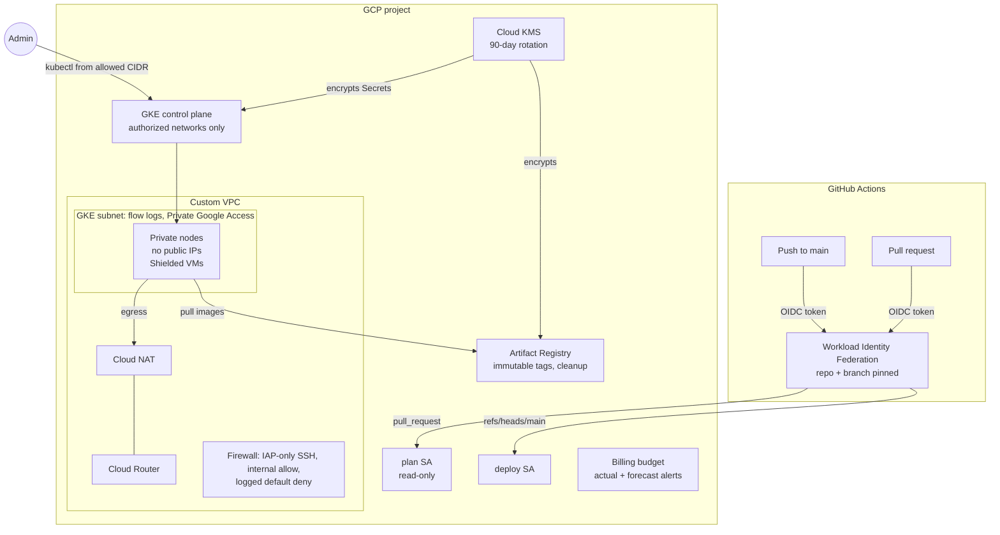

# gcp-landing-zone

[](https://github.com/s3nafps/gcp-landing-zone/actions/workflows/ci.yml)


[](LICENSE)

A Terraform landing zone for Google Cloud. It builds a **private, hardened GKE platform**
in an existing project, with **keyless CI** from GitHub Actions. Everything is split into
small, documented, tested modules.

It applies what the Google Cloud Associate Cloud Engineer exam covers (VPC design, private
GKE, IAM, KMS, Artifact Registry and billing controls) in the way I would run it in
production.

## What it builds



| Area | Controls |
|---|---|
| **Network** | Custom-mode VPC, regional routing. Subnet with pod and service secondary ranges, Private Google Access and VPC flow logs. Cloud NAT for egress, logging errors. Firewall allows SSH only from the IAP range, plus an explicit logged deny-all. Optional Private Service Access for Cloud SQL and Memorystore |
| **GKE** | Private nodes. Control plane limited to authorized networks (`0.0.0.0/0` rejected by validation), with optional private endpoint. **Workload Identity**, **Dataplane V2** (NetworkPolicy), Shielded Nodes with Secure Boot, **Binary Authorization**, **KMS-encrypted Secrets**, client certificates off, legacy ABAC off, GKE metadata server, release channel, maintenance window, managed Prometheus, security posture scanning |
| **Nodes** | Dedicated service account with six narrow roles instead of the Compute default (Editor). COS containerd image, autoscaling, auto-repair and auto-upgrade, surge upgrades with zero unavailable nodes. Spot VMs optional |
| **Encryption** | Customer-managed keys for GKE Secrets and Artifact Registry, rotated at most every 90 days, each usable only by its service agent, protected from `terraform destroy` |
| **IAM** | Additive bindings only, with validation that rejects `roles/owner` and `roles/editor`. **Workload Identity Federation** for GitHub: the provider accepts tokens only from this repository and only from `main` or pull requests. Pull requests can impersonate only a **read-only plan account**, and only `main` can impersonate the **deploy account**. No service account keys exist anywhere |
| **Supply chain** | Artifact Registry with immutable tags, CMEK, and cleanup policies (keep the 10 most recent versions, delete untagged images after 7 days) |
| **Cost** | Billing budget with alerts at 50/90/100% of actual spend and 100% of forecast. Dev uses a zonal cluster on Spot VMs |
| **State** | `bootstrap/` creates a versioned, uniform-access state bucket with public access prevention, soft delete and access logging |

## Environments

| | `envs/dev` | `envs/prod` |
|---|---|---|
| Cluster | Zonal | Regional (3 zones) |
| Nodes | `e2-standard-2` **Spot**, 1-3 | `e2-standard-4` on-demand, 1-5 per zone |
| Release channel | REGULAR | STABLE |
| Private Service Access | off | on |
| Deletion protection | off | on |
| Monthly budget | 50 | 500 |

Each environment has its own state prefix and should live in its own project.

**Rough cost:** dev costs about $20-30/month. Spot nodes and NAT make up most of it, and one
zonal cluster's management fee is covered by the GKE free tier. Prod with three on-demand
`e2-standard-4` nodes is roughly $350-400/month before traffic. Check the
[pricing calculator](https://cloud.google.com/products/calculator) for your region.

## Quick start

```bash
# 1. One-time: create the state bucket (local state)
cd bootstrap
cp terraform.tfvars.example terraform.tfvars && $EDITOR terraform.tfvars
terraform init && terraform apply

# 2. Deploy an environment
cd ../envs/dev
cp terraform.tfvars.example terraform.tfvars && $EDITOR terraform.tfvars   # project, your IP, repo
terraform init -backend-config="bucket=$(terraform -chdir=../../bootstrap output -raw state_bucket)"
terraform plan
terraform apply

# 3. Use the cluster
$(terraform output -raw get_credentials_command)
kubectl get nodes
```

### Keyless CI

After the first apply, wire GitHub Actions to the identities it created. These are
repository **variables**, not secrets, because there is nothing secret in them:

| Variable | Value |
|---|---|
| `GCP_PROJECT_ID` | your project |
| `GCP_WORKLOAD_IDENTITY_PROVIDER` | `terraform output -raw github_workload_identity_provider` |
| `GCP_PLAN_SERVICE_ACCOUNT` | `terraform output -raw github_plan_service_account` |
| `GCP_DEPLOY_SERVICE_ACCOUNT` | `terraform output -raw github_deploy_service_account` |
| `TF_STATE_BUCKET` | the bootstrap bucket |

Grant the plan account `roles/storage.objectViewer` and the deploy account
`roles/storage.objectAdmin` on the state bucket (`state_admins` in `bootstrap`).
Pull requests then get a plan comment ([plan.yml](.github/workflows/plan.yml)), and merges to `main`
apply dev ([apply.yml](.github/workflows/apply.yml)), gated by the `dev` GitHub environment.

## Repository layout

```text
bootstrap/                 # state bucket (run once, local state)
envs/
  dev/  prod/              # thin roots: backend, provider, one module call
modules/
  landing-zone/            # composes everything below
  project-services/        # API enablement
  network/                 # VPC, subnet, NAT, firewall, PSA
  kms/                     # key ring and CMEKs
  gke/                     # private cluster and node pool
  iam/                     # bindings and GitHub Workload Identity Federation
  artifact-registry/       # Docker repository
  budget/                  # billing budget
```

Every module has a generated README with its inputs and outputs (terraform-docs).

## How it is tested

No GCP credentials are needed for any of this. It all runs in CI on every push.

| Check | Tool |
|---|---|
| Formatting | `terraform fmt -check` |
| Validation | `terraform validate` on `bootstrap`, `envs/dev`, `envs/prod` against provider 8.x |
| **Unit tests** | **25 `terraform test` cases with a mocked Google provider.** They assert security properties directly, for example: nodes are private, Secrets are KMS-encrypted, the GKE metadata server is enforced, the node SA has no primitive roles, SSH is IAP-only, a logged deny-all exists, the federation condition pins repository and branch, and pull requests can only reach the read-only account. They also prove that invalid input is rejected (an open control plane, a non-/28 control plane range, Owner grants, wildcard deploy refs, write roles on the plan account, rotation over 90 days) |
| Lint | `tflint` with the Google ruleset and all Terraform rules |
| Security | `checkov`: 138 passed, **0 failed** |
| Docs | Module READMEs must match `terraform-docs` output |

A quick mutation check: setting `enable_private_nodes = false` makes the GKE suite fail with
*"Nodes must not have public IPs."*

### Accepted checkov exceptions

Each one is documented inline next to the resource:

| Check | Why it is skipped |
|---|---|
| `CKV_GCP_12` network policy | Dataplane V2 enforces NetworkPolicy natively and cannot be combined with the legacy `network_policy` block |
| `CKV_GCP_65` Google Groups for RBAC | Needs a Google Workspace domain. Set `rbac_security_group` to enable it |
| `CKV_GCP_125` GitHub OIDC trust | The condition pins repository and exact `sub` claims but is built from variables that checkov cannot evaluate. `modules/iam/tests` asserts the rendered string |

## Local development

```bash
make check     # fmt, validate, test, tflint, checkov
make docs      # regenerate module READMEs
make plan ENV=dev
```

[pre-commit](https://pre-commit.com) hooks are configured in `.pre-commit-config.yaml`.

## Roadmap

- Organization-level variant: folders, org policies (`constraints/compute.vmExternalIpAccess`,
  `iam.disableServiceAccountKeyCreation`), centralized log sink
- Shared VPC host/service project split
- Config Sync / Argo CD bootstrap for cluster workloads

## License

[MIT](LICENSE) (c) Mohamed Senator
